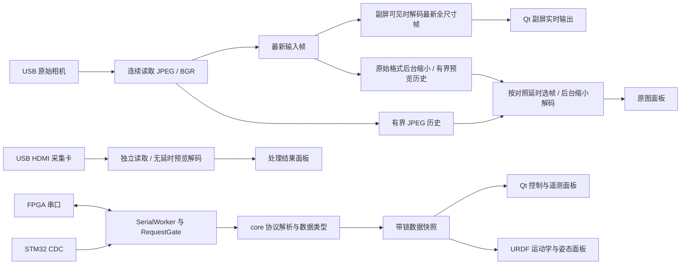

# 开发与维护说明

## 层次与线程

`core` 不依赖 Qt、OpenCV 或 pyserial；其中运动学依赖 NumPy，其余协议、请求门控和缓存仅使用标准库。`evaluation` 为无 Qt 的 OpenCV / NumPy 算法层。`devices` 负责 I/O、模拟设备及后台评估调度，`ui` 负责 Qt 绘制和用户操作，主窗口控制设备生命周期。入口与配置独立于视图。



- 一个视频源有读取、预览、全尺寸输出三个 Python 线程，Linux FFmpeg 本身为子进程。MJPG 使用 `-c:v copy -f image2pipe -flush_packets 1` 保留设备 JPEG，读取线程不做解码或缩放；其他格式读 BGR。JPEG 增量解析按段长度跳过 APP 内嵌缩略图，处理扫描数据转义、重启标记及渐进多扫描，限制单帧 16 MiB。
- 预览线程最多 30 Hz，MJPG 从有界压缩历史中按本地时间和用户延时选帧，用 OpenCV 半尺寸 JPEG 解码，再以线性插值缩至 640×360。原始格式每次只缩小最新输入，积累有界预览历史后选延时帧。解码耗时超过周期时直接选择下一个最新目标，禁止 FIFO 解码任务队列，也禁止为了 UI 重编码全尺寸 JPEG。
- 应用入口将 OpenCV 内部线程数设为 2，避免两路采集、预览和副屏的并行任务再各自争用大量缩放线程。
- 全尺寸输出仅在副屏可见时启用，独立选择最新输入，不读取对照延时。采集卡只做预览解码。每次断连增加会话代号；解码结果仅在会话和设置版本仍匹配时发布，避免旧任务在清空后重新填入缓存。
- 读取管道采用 selector 和 3 秒超时，停止时唤醒工作线程、terminate FFmpeg，必要时 kill 并回收；生命周期检查覆盖视频的所有线程。OpenCV 阻塞驱动的限制见下文。
- 一条串口一个工作线程，短超时读取，独立增量解析器；每次重新打开均清空旧接收数据并创建解析器。
- Qt 对象只在主线程访问。工作线程发布带锁快照；图像通过最新帧邮箱及有界历史供 Qt 定时拉取，不为每帧发送排队信号。
- NumPy 视频帧发布后不再修改，`VideoView` 持有图像数组，确保 QImage 引用的内存存活。
- Qt 定时器每 16 ms 检查副屏和已解码的硬件预览邮箱，仅新序号触发绘制；预览解码最多 30 Hz，不在定时器内再做 1/30 秒取整限频（否则 16 ms 的倍数会退化成约 21 Hz）。设备状态和姿态界面约 10 Hz。采集与串口读取不随界面频率降采样；绘制仍依赖主线程调度，实际显示频率应实测。
- 设备事件队列、串口命令队列、图像缓存、界面日志均有容量上限。JPEG 按字节数记账；BGR 历史按 ndarray.nbytes 记账且只保存缩小版本。全尺寸输入、全尺寸解码及已解码预览均只保留最新帧。接收时间戳贯穿解码，不以解码完成时间冒充新鲜输入。
- “断开”停止 Qt 拉取，再通过清理线程结束设备任务，最后用 Qt 信号恢复控件。退出窗口沿用相同流程。旧工作线程未结束时禁止重新连接。
- `LivePage` 仅包含双图与状态，`ControlWindows` 构建设备、FPGA/Gamma、姿态、日志四个非模态窗口；关闭窗口仅隐藏，主窗口统一持有。姿态窗口隐藏时跳过模型运动学/绘制更新，读数和串口仍正常刷新。
- `EvaluationPage` 管理参数、结果与导出；`EvaluationWorker` 使用最新全尺寸输入邮箱，约 1 Hz 检测，连续三次不同帧角点稳定才评估。评估视频源设置 `preview_enabled=False`，不积累 JPEG 历史或运行主页预览解码。相机仅在副屏可见时额外进行全尺寸解码，IMU 不启动。
- 两个页面互斥：切换页面先停 Qt 定时器并后台清理任务，清理完成后恢复当前页启动按钮。评估停止标记在检测后和发布前检查，结果只走单个带锁最新邮箱，防止旧报告在切页后重新发布。停止超时禁止再次启动。静态图解码、角点检测、软件矫正、几何与 SFR 全在后台，Qt 仅展示已生成的缩小叠加图。

## FPGA 状态和请求

`RequestGate` 只允许一个未完成请求，仅相同序号的 STATUS 能释放门控。GAMMA_STATS 使用独立序号，不能完成请求。前台操作也有 `busy` 门控，避免重复点击堆积 SET。

连接时与每 250 ms 查询 GET_STATUS。用户命令优先于下一次轮询，仍等待已有请求响应。STATUS 负载校验成功后才匹配 ACK。请求超时后关闭串口，2 秒后重连并查询，SET 不自动重放，以应对“命令已经生效但 ACK 丢失”。UI 禁用 pending 期间的开关提交，同时保留查询与遥测控制。

界面复选框是“目标草稿”；只在设备 requested/available 改变、出错或重新获取状态时同步，正常状态轮询不会覆盖用户尚未提交的修改。每次提交完整三位掩码，禁用不支持的位。协议 result 非零会写入日志。

Gamma 数据记录两个时间：最近合法统计接收时间、最近不同 `frame_index` 的接收时间。序号 32 位回绕时，新的不同值仍视为更新。它们都是本地时间，不能推导传感器或最终 HDMI 的采样时间。

## 扩展方式

### 新增 FPGA 功能或消息

1. 先在 `core/protocols.py` 增加类型与编解码，保持旧版本兼容；修改线协议版本时明确旧设备行为。
2. 在 `tests/test_protocols.py` 加入来自真实协议的完整字节样例、分块和异常用例。
3. 在 `SerialWorker._session()` 接入新的快照数据，保持锁范围短，不触碰 Qt 对象。
4. 在 `ui/widgets.py` 增加可复用显示组件，在 `control_windows.py` 增加独立窗口控件或更新现有遥测。为 `DemoRig` 增加对应模拟数据，以便无设备开发。

当前三个功能位的协议约束是 `0x07`，新增位需同步固件、掩码校验、功能控件和测试，不能只在 UI 增加复选框。

### 新增视频后端

在 `devices/video_sources.py` 提供与现有 Source 一致的 `read(stop_event) -> JPEG bytes / BGR uint8 H×W×3 / None`、`close()` 接口，通过 `VideoWorker` 工厂选择。JPEG 必须是一张完整图像，原始格式必须为连续 BGR 数组；发布后不可修改。后端应具备可中断或有超时的读取，并明确实际格式和时间戳来源。不要把 I/O 放入 Qt 的 `tick()`。

### 新增设备

沿用 `start()`、`stop()`、`snapshot()`、`drain_events()` 约定。串口快照保持不可变数据对象；视频快照保留帧序号和本地单调时间。增加配置字段时提供默认值和校验，不因读取旧配置而要求新字段必填。

### 替换模型

设置中选择 URDF。当前加载器支持 STL mesh、visual origin/scale、fixed/revolute/continuous 关节、URDF 轴与 RPY 原点；使用 yaw_joint/pitch_joint 接收姿态。复杂模型或不同关节命名应在视图前增加映射层。`package://` 按所选 URDF 所在包根目录解析；不依赖 ROS 包索引。多包资源、棱柱关节、纹理以及其他网格格式需要扩展加载器。

视图采用 CPU QPainter 正交投影、深度排序和简化网格，不是精密 CAD 渲染。顶点聚类用于控制绘制开销，保留源资产。高精度、复杂遮挡或更多模型场景可用同一运动学接口替换为专门的 GPU 视图。

### 新增图像评估指标

在 `evaluation/` 增加无 Qt 的算法，统一使用原始图像像素坐标；`analyzer.evaluate_board()` 汇总可 JSON 序列化的数值、有效性与原因，`EvaluationPage.show_result()` 显示结果。先用解析图像或已知变换验证数值趋势和误差，再接入真实输入。不能把缩小的主页预览用于定量测量，也不能把单应性矫正后的 ROI 用于原始图像的 MTF50 计算。

每个指标明确适用范围和缺失条件；条件不足返回不可用而不是 0 或通过。修改报告字段时维护 `schema_version` 和导出兼容性。详细测量假设与参数约定见 [评估使用说明](evaluation.md)。

## 板测清单

自动测试已经验证协议与控制流程，以下项目需实际接入设备后记录结果：

- 确认 FPGA 位流支持当前 PC 控制协议；设备 VID/PID、视频节点和串口选择正确。
- 单独打开每个视频节点，检查 1920×1080、像素格式、驱动允许的 60 fps 模式；共享 USB 控制器不足时调整连接或编码格式。
- 接上 FPGA 输入链路，确认副屏物理 1080p60 和实际 HDMI 有效画面；分别核对 PC 摄像头实际采集率、副屏输出节奏、FPGA 输出率和采集卡实际速率。
- 三项功能的八种掩码组合，确认 ACK、requested、pending、applied 和硬件 LED；拔掉 HDMI 输入时 SET 应保留 pending，再接回后生效。
- 无有效统计、Gamma 关闭、遥测关闭/重新开启、GET_SNAPSHOT；检查 FPGA 原始像素数、亮度值、暗部/高光比例与帧编号持续变化。
- 移动场景逐步调整对照延时，确认主页原图和 FPGA 图像更接近；调整延时不应影响副屏实时链路。
- 分别朝正负方向转动云台，确认 yaw、pitch、roll 解码；校准 yaw/pitch 方向与零点，检查 ±180° 附近模型显示不产生数值失控。roll 仅显示读数。
- 分别拔插相机、采集卡、两个串口和副屏，确认错误提示、缓存清理、自动重试；检查另一路设备继续工作。
- 串口没有响应时确认超时断开且不会自动重放 SET；有响应但无 SOF 时确认应用持续 pending 且查询仍正常。
- 连续运行，观察内存上限、日志轮转、CPU 负载；多次连接/断开与关闭窗口后确认没有遗留 FFmpeg 子进程。
- 在实物棋盘格上分别验证原始相机、FPGA 采集卡、软件参考；核对内角点数与标定尺寸，故意移走/移动图卡确认旧结果清除和稳定等待。固定照明曝光后测中心与边角，记录 SFR 不可用原因及实际阈值。
- 多次切换主页与评估，确认设备释放、没有同时采集或遗留评估任务；评估 FPGA 时开启副屏确认输入链路仍工作。导出 JSON 并核对输入模式、标定 SHA256、状态掩码与当前测量一致。

## 自动验证记录

自动测试覆盖协议、串口、JPEG 输入、后台视频与界面流程。验证环境：Python 3.12，PySide6 6.12，NumPy 2.5，OpenCV headless 4.14，pyserial 3.5。测试使用 `unittest` 和 QtTest，不需要额外的 pytest 插件。

```bash
QT_QPA_PLATFORM=offscreen .venv/bin/python -m unittest discover -s tests -v
```

PTY 测试通过操作系统伪终端实际调用 pyserial，模拟遥测插队、过期 ACK、延迟应用和超时；它不等于实物串口测试。视频测试通过系统 FFmpeg 生成 1080p MJPEG，实际使用子进程、selector 和管道分帧；通过 120 fps 模拟源和约 16 fps 慢解码器验证采集不受解码回压、旧帧跳过及历史内存上限。离屏 GUI 测试同时输入两路 JPEG，确认后台解码、实时预览、延时调整、副屏按需解码和所有视频线程停止。上述测试不等于实物相机、采集卡和双屏端到端性能验证。
