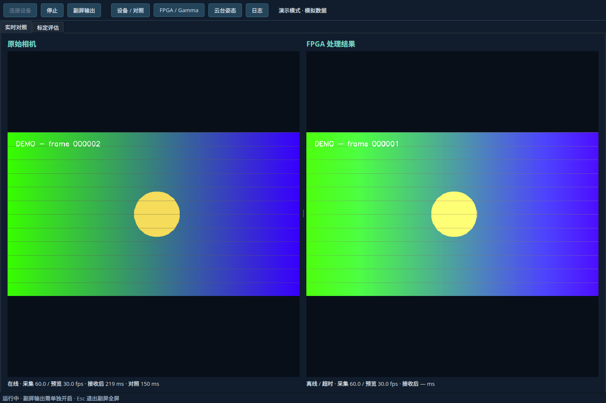
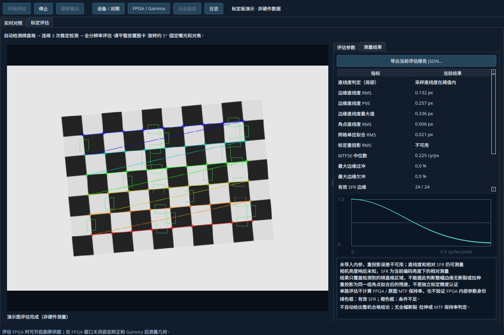

# ECSDC FPGA PC 上位机

基于 Python / PySide6（Qt）的图像处理工作台，保留 `Device/` 中的协议、参考脚本和原始模型。主页以原始图像、FPGA 处理图像并排显示为主；设备设置、FPGA/Gamma、云台姿态与日志通过顶部按钮打开独立窗口。另有“标定评估”页面，与主功能互斥运行。

| 面板 | 已实现功能 |
| --- | --- |
| 原始视频 | USB 相机 1920×1080 / 60 fps 采集请求；主页预览；0～2000 ms 对照延时 |
| FPGA 处理结果 | 独立 USB HDMI 采集卡输入，与原图并排显示；实际采集帧率及超时提示 |
| FPGA 控制与 Gamma | 去畸变、姿态矫正、自动 Gamma 三开关；requested/applied/pending/available 状态；遥测启停、快照、曲线及亮度统计 |
| 云台姿态 | STM32 USB CDC 三轴解码；原有 URDF/STL 模型的 yaw/pitch 关节运动；三轴读数、方向设置、模型零点校准 |
| 标定评估 | 自动检测棋盘格；直线度 RMS/P95/最大误差、相对 SFR/MTF50、过冲/欠冲、标定参数解析及重投影残差；JSON 报告 |

原始视频另有独立副屏全屏输出，供 FPGA HDMI 输入使用。**主页延时补偿不影响副屏实时输出**。后台任务与界面分离，视频和串口支持断线重试；提供无需设备的演示模式。



## 启动

建议 Python 3.10～3.13，在本目录运行。已有 `.venv` 时可直接安装依赖。

```bash
# 使用 uv
uv venv .venv
uv pip install --python .venv/bin/python -r requirements.txt
.venv/bin/python -m fpga_host --demo
```

也可使用标准 Python 工具：

```bash
python3 -m venv .venv
.venv/bin/python -m pip install -r requirements.txt
.venv/bin/python main.py --demo
```

Windows 对应命令：

```powershell
py -m venv .venv
.venv\Scripts\python -m pip install -r requirements.txt
.venv\Scripts\python -m fpga_host --demo
```

依赖为 `PySide6-Essentials`、`numpy`、`opencv-python-headless`、`pyserial`。Essentials 提供本项目使用的 Qt 模块，不需要额外安装 WebEngine。请使用 headless OpenCV，避免其自带 Qt 插件与 PySide6 冲突。

Linux 硬件模式建议准备系统 `ffmpeg`、`v4l2-ctl` 和 `xrandr`；分别由发行版的 FFmpeg、v4l-utils、x11-xserver-utils 等软件包提供。自动后端优先使用系统 FFmpeg / V4L2，未安装 FFmpeg 时使用 OpenCV。FFmpeg 打开失败会记录原因并重试；可在设置中明确切换 OpenCV 后端。

```bash
.venv/bin/python -m fpga_host                          # 硬件界面，点击连接设备
.venv/bin/python -m fpga_host --config ./settings.json  # 指定配置文件
.venv/bin/python -m fpga_host --demo --quit-after 5     # 限时演示
```

可选 `pip install -e .` 后使用 `fpga-host` 命令。推荐从源码目录运行或使用可编辑安装，保留 `Device/` 模型资产；打包分发时须同时部署模型，并在设置中指定路径。

## 硬件接线与操作

1. 原始 AR0234 相机接 PC USB；PC 副屏 HDMI 输出接 FPGA HDMI 输入；FPGA HDMI 输出接 USB 采集卡，采集卡 USB 接 PC。
2. FPGA 的 CP210x 和 STM32 的 USB CDC 分别接 PC；它们是两条独立串口。
3. 在系统显示设置中启用扩展桌面，把 FPGA 所接副屏信号设为 **1920×1080 @60 Hz**。应用不会自动修改系统显示模式。
4. 点击顶部“设备 / 对照”，打开其中的“设备设置”，选择两路不同的视频节点、两个不同串口和副屏。原始相机与采集卡的像素格式可分别选择 MJPG / YUYV / NV12。Linux 通常使用 `/dev/videoN`，Windows 使用数字相机索引。
5. 点击“连接设备”。检查两路采集 / 预览 fps；再点击“副屏输出”。`Esc` 仅退出副屏全屏。显示器移除后应用会停止副屏输出。
6. 在“设备 / 对照”窗口调整“对照延时”，使运动目标在两幅预览中尽量一致。该值延迟原始预览，补偿整条 FPGA/采集卡链路相对原始视频的延时；时间依据 PC 本地接收时间，无法提供逐帧硬件同步。
7. 打开“FPGA / Gamma”，选择三个功能的目标状态后点击“应用开关”。界面分别显示请求掩码、已应用掩码和等待状态；不支持的位禁用，pending 时禁止再次 SET。无输入 SOF 时保持等待生效，可继续查询状态。
8. 打开“云台姿态”，转动云台确认 IMU 正方向。通过设备设置中的 yaw/pitch 方向和“当前姿态设为模型零点”完成显示校准；零点只作用于模型，本次连接结束后清除，不改变固件或三轴原始读数。

首次启动会按 VID/PID 建议设备；保存过配置后优先使用所选路径。多个同型号串口需手动指定，视频设备的多个节点中也可能含不能采集的元数据节点。

| 设备 | VID:PID | 用途 |
| --- | --- | --- |
| USB Camera AR0234 | `1bcf:2cd1` | 原始视频 |
| UGREEN 25854 | `2b89:5854` | FPGA HDMI 采集 |
| CP210x | `10c4:ea60` | FPGA 控制 / Gamma 遥测 |
| STM32 Virtual COM | `0483:5740` | IMU 姿态 |

两条串口均使用 115200 / 8N1 / 无流控。FPGA 需烧录支持当前 PC 控制协议的位流；旧位流无响应时会超时重连。Linux 端需具备设备所属 `video` / `dialout` 等组的访问权限，具体以发行版为准。

## 标定评估

切换到“标定评估”会先停止当前主功能，再点击“开始评估”启动。支持原始相机、FPGA 采集卡或静态文件；默认棋盘格为 **9 列 × 6 行内角点**（10×7 个方格）。实时画面连续三次检测稳定后自动测量，约每秒更新；检测丢失或输入超时会清除旧结果。演示模式在该页生成倾斜棋盘格，不打开硬件。

右侧“评估参数”可设置图卡、输入是否已经矫正、亮度响应、误差阈值，以及导入 MATLAB JSON / OpenCV JSON、YAML 内参。检测成功后自动显示“测量结果”，包含叠加 ROI、指标和 SFR 曲线；运行期间可导出当前 JSON 报告。静态图像在后台解码并评估一次。

评估使用全分辨率输入，在独立后台线程计算；不启动主页预览与 IMU。评估 FPGA 采集卡时仍可开启相机副屏供图，并通过“FPGA / Gamma”调整功能。导入参数仅供 PC 参考，不向 FPGA 下载；可对原始图像执行软件去畸变作为参考。

MTF50 是相对斜边测量，并非 ISO 12233 认证；直线度只代表棋盘格覆盖区域。默认阈值可调整，不代表整机验收标准。测量条件、文件格式和指标解释见 [评估使用说明](docs/evaluation.md)。



## 数据含义与运行边界

- 相机和采集卡都请求 1080p60，实际吞吐受 USB 带宽、设备格式、解码与桌面合成影响。界面分别显示实际采集率和后台预览发布率。主页预览最多约 30 Hz；副屏使用独立实时帧、以 16 ms 精确定时器请求刷新。软件刷新请求不等于实测 HDMI 输出帧率，板测需核对端到端效果。
- X11 优先读取 `xrandr` 当前信号模式，避免将 GNOME 缩放后的桌面尺寸误作 HDMI 分辨率；无法查询时采用 Qt 屏幕信息。Wayland、远程桌面或分数缩放下还需在系统中确认物理时序。副屏仅允许独立的 1080p、约 60 Hz 屏幕。
- Linux 的自动 / FFmpeg 后端在 MJPG 模式直接读取设备 JPEG，不再通过管道传输完整 BGR 图像，也不在 PC 重新编码。相机和 FPGA 采集卡均可使用此路径；两路设备需要支持所选 MJPG 模式。预览后台按需半尺寸解码后缩至 640×360，处理跟不上时跳过旧帧。副屏可见时，相机另行解码最新全分辨率帧；主页对照延时独立生效。
- 原始相机历史最多 2.5 秒且不超过 128 MiB，采集卡历史最多 0.25 秒且不超过 128 MiB。MJPG 历史保存设备 JPEG；OpenCV / YUYV / NV12 路径保留后台生成的 640×360 预览历史。高码率可能使可保留时间缩短，缓冲不足时显示“延时缓冲中”。
- 检查实时性时，将主页“对照延时”设为 **0 ms**（默认 150 ms 会主动延迟原图）。视频栏“接收后”表示当前预览帧从本机接收到现在的时间，包含设定的对照延时和后台解码 / 界面调度时间，不包含设备内部、USB 上游或真实 HDMI 端到端延迟。若预览 fps 偏低但帧龄稳定，说明在跳帧保持最新画面；若采集率本身偏低，应检查设备模式、曝光和 USB 带宽。
- Gamma 均值分母为零时显示“无效”；暗部、高光比例均来自增强前图像。Gamma 关闭时曲线视图显示恒等映射，均值仍采用实际上报值。曲线是协议公式的示意图，并非 FPGA LUT 逐项读回。
- Gamma 同时展示本地接收距今时间和帧编号变化时间。反复收到同一帧不会重置“帧编号未更新”时间；关闭遥测后保留最近快照。统计属于输入 Gamma 阶段，不等同于最终 HDMI 输出帧。
- IMU 连续 0.5 秒无有效帧时标为超时，三轴读数无效，模型保留最后姿态。协议没有采样序号、时间戳及传感器就绪位，不能用通信正常推断传感器正常。
- 模型按 URDF 中的关节原点与轴旋转，支持 `package://` 资产路径，不依赖 ROS/OpenGL。原模型没有 roll 关节，所以 roll 以读数显示。建模导出的零关节限位不用于限制姿态显示；yaw 并非已校准的绝对航向。视图网格做了简化，源 STL 保留原样。
- 各设备错误独立记录并每 2 秒重试；FPGA 命令 1 秒无匹配 STATUS 时断开，重连后读取实际状态，不盲目重发 SET。断开操作后台清理资源，避免等待 I/O 阻塞界面。少数 OpenCV 驱动可能无法结束阻塞读取，此时禁止再次连接并提示重启程序；Linux 优先使用有读取超时的 FFmpeg 后端。

默认配置保存至 Qt 的应用配置目录（Linux 通常为 `~/.config/ECSDC/ECSDC-FPGA-Host/settings.json`）；可以通过 `--config` 自定义。配置使用版本号、字段校验和临时文件原子替换；停止后可修改设备与模型。两幅图像之间的分隔条可拖动调整宽度；独立工具窗口关闭后可从顶部重新打开。

## 目录与扩展

```text
fpga_host/
  app.py                 启动参数、应用初始化、首次设备发现
  config.py              配置数据与 JSON 持久化
  core/
    protocols.py         FPGA / IMU 编解码与数据类型
    requests.py          单请求门控、序号匹配和响应超时
    buffering.py         带本地时间戳、容量限制的 JPEG / BGR 缓存
    jpeg.py              JPEG 增量分帧与尺寸解析
    model.py             URDF / STL 加载、网格简化、正向运动学
  devices/
    video.py             连续采集、预览 / 副屏独立解码及最新帧邮箱
    video_sources.py     FFmpeg / OpenCV 视频采集适配器
    serial_link.py       串口工作线程、遥测快照、重连
    discovery.py         USB 视频节点发现
    displays.py          X11 物理信号模式检测
    demo.py              模拟图像、遥测及姿态
    evaluation.py        独立评估线程、稳定检测、最新结果邮箱
  evaluation/
    calibration.py       MATLAB / OpenCV 参数解析、坐标约定与校验
    analyzer.py          棋盘格检测、软件参考、重投影与报告
    geometry.py          角点与真实灰度边缘的直线度测量
    sfr.py               原始像素坐标下的相对斜边 SFR / MTF50
  ui/
    main_window.py       页签控制、设备生命周期、互斥启停
    live_page.py         原始 / 处理双图主页
    control_windows.py   设备、FPGA/Gamma、姿态、日志独立窗口
    evaluation_page.py   评估参数、结果、SFR 曲线及报告导出
    settings_dialog.py   设备与模型设置
    widgets.py           视频、Gamma 曲线、URDF 可复用视图
Device/                  协议与硬件原始参考资产
tests/                   协议、缓存、运动学、虚拟串口及 Qt 交互测试
docs/development.md      线程约定、扩展步骤与板测清单
```

实现和维护约定见 [开发说明](docs/development.md)。设备线协议依据 [FPGA 协议](Device/fpga_uart/reference/pc_control_protocol.md) 与 [IMU 协议](Device/imu_usbdcdc/reference/usb_receive_manual.md)。

## 验证

```bash
QT_QPA_PLATFORM=offscreen .venv/bin/python -m unittest discover -s tests -v
QT_QPA_PLATFORM=offscreen .venv/bin/python -m fpga_host --demo --config /tmp/pc-demo.json --quit-after 3
```

Windows 可先设置 `$env:QT_QPA_PLATFORM="offscreen"` 再运行 `python -m unittest discover -s tests -v`。虚拟串口 PTY 集成测试仅在 POSIX 平台运行，其余测试可跨平台执行。

当前自动验证涵盖协议样例、所有拆包边界、校验失败重同步、半包/粘包/噪声、序号回绕、遥测与 ACK 交错、pending、生效查询、超时、重复统计新鲜度、缓冲容量、配置、实际 URDF 变换、JPEG 分帧与渐进格式、真实 FFmpeg 管道、慢解码跳帧、双路后台解码、预览延时与副屏独立性、演示开关和连接生命周期。实物视频与串口、双屏实际时序尚需按开发说明的板测清单确认。

评估测试包含 MATLAB 坐标转换、OpenCV 标定文件、解析异常、解析高斯斜边的理论 MTF50、模糊清晰度下降、已知弯曲网格、已知相机重投影、稳定检测/丢失、取消任务、双页面互斥、全分辨率 JPEG 评估及报告导出。合成图卡通过不等于实物光学性能通过。
